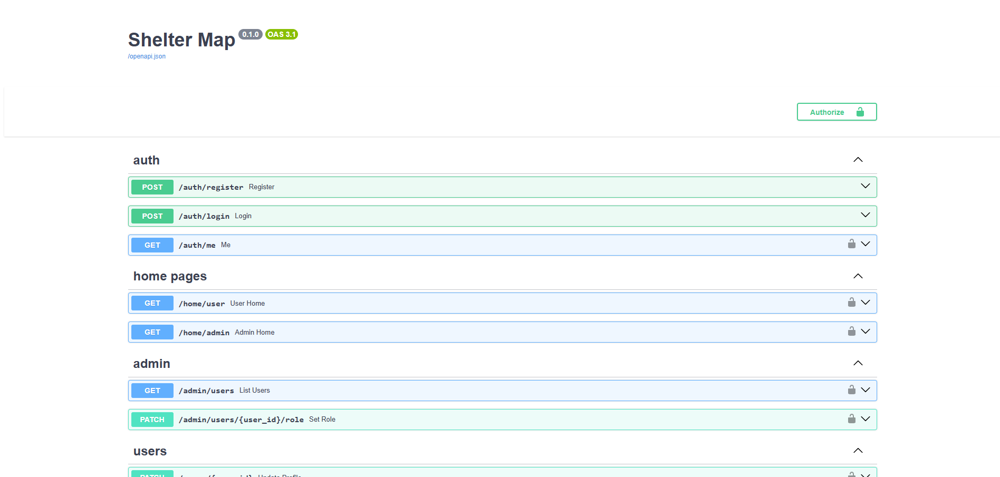
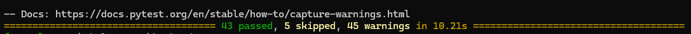

# Лабораторна робота №2. Користувачі, ролі та розмежування доступу

## Що реалізовано

- База даних користувачів (таблиця `users`) і відгуки про стан укриттів (`reports`).
- Дві ролі: `user` і `admin`.
- Публічна реєстрація (лише роль `user`), вхід, профіль `/auth/me`.
- Домашні сторінки-заглушки: `/home/user` і `/home/admin`.
- MVP: геопошук укриттів, CRUD укриттів для адміна, відгуки користувачів.
- Міграція Alembic і 48 автоматичних тестів pytest.

## Модель даних

| Таблиця | Призначення |
|---|---|
| `users` | email (унікальний), ім'я, хеш пароля, роль, прапорець активності |
| `places` | укриття й пункти обігріву з геоточкою (PostGIS `geography`) |
| `reports` | відгук користувача про стан укриття; FK на `places` і `users` |

## Обґрунтування архітектурних рішень

**JWT Bearer-токени замість серверних сесій.** Сервер не зберігає стан між запитами, тож
backend залишається stateless і масштабується горизонтально за Nginx, як на схемі з лаби №1.
Токен містить лише `sub` (id користувача) і `exp`; роль щоразу береться з БД, тому зміна ролі
або деактивація користувача діє одразу.

**Argon2id для паролів.** Пароль у відкритому вигляді ніде не зберігається. Argon2id є сучасним
стандартом: стійкий до перебору на GPU, сіль і параметри зберігаються в самому хеші.
Для неіснуючого користувача перевіряється хеш-заглушка, щоб час відповіді не виказував,
чи зареєстрований email.

**RBAC через залежності FastAPI.** Перевірка ролі винесена в `require_roles(...)`, а не
розкидана по обробниках: кожен захищений маршрут явно декларує, хто має доступ.
Без токена відповідь `401`, з токеном недостатньої ролі `403`.

**Карта укриттів публічна.** У надзвичайній ситуації не можна змушувати людину входити
в акаунт, тому `GET /places/nearby` відкритий. Це також відповідає сценарію навантаження:
публічні read-запити можна кешувати в Redis.

**Адміністратора не можна створити через реєстрацію.** Реєстрація завжди створює роль `user`
(навіть якщо в тілі запиту передати `role=admin`), що захищає від підвищення привілеїв.
Адмін створюється командою `python -m app.cli`, а далі може змінювати ролі інших.

**Захист від IDOR (горизонтальне розмежування).** Редагувати профіль може лише його власник
або адмін; редагувати й видаляти відгук може лише автор або адмін. Інакше `403`.

**Alembic замість `create_all`.** Схема БД змінюється версіонованими міграціями.
Міграція `0001` також вмикає розширення PostGIS і створює GiST-індекс для геопошуку.

## Матриця доступу

| Маршрут | Анонім | user | admin |
|---|---|---|---|
| `GET /places/nearby`, `GET /places/{id}` | 200 | 200 | 200 |
| `GET /auth/me`, `GET /home/user` | 401 | 200 | 200 |
| `GET /home/admin`, `GET /admin/users` | 401 | 403 | 200 |
| `POST/PATCH/DELETE /places` | 401 | 403 | 2xx |
| `POST /places/{id}/reports` | 401 | 201 | 201 |
| `PATCH/DELETE /reports/{id}` чужий | 401 | 403 | 2xx |
| `PATCH /users/{id}` чужий | 401 | 403 | 200 |

## Покриття вимог тестами

| Сценарій із завдання | Файл і тести |
|---|---|
| Анонімний доступ, 401 | `test_access_control.py`: `test_anonymous_gets_401_on_protected_routes`, неправильний і підроблений токен |
| Успішний вхід і помилки входу | `test_auth.py`: вхід, неправильний пароль, невідомий email, реєстрація |
| Вертикальне розмежування, 403 | `test_access_control.py`: `test_regular_user_gets_403_on_admin_routes` |
| Горизонтальне розмежування (IDOR), 403 | `test_access_control.py`: чужий профіль, чужий відгук |
| Юніт-тести безпеки | `test_security_unit.py`: хешування, JWT, прострочений токен |
| MVP | `test_places_mvp.py`: геопошук, фільтри, CRUD, відгуки |

## Перевірка

Запуск: `docker compose up -d db redis` (папка `infra`), `alembic upgrade head`, `uvicorn app.main:app --reload` (папка `backend`).

**Swagger UI (`/docs`)** — усі маршрути: `auth`, `home pages`, `admin`, `users`, далі `places` і `reports`; кнопка **Authorize** для входу за токеном.

**Автотести (`pytest`)** — на скріні 43 пройдені тести; 5 пропущено — це тести кешу лаби 7, вони пропускаються автоматично, якщо Redis не запущений (з Redis проходять усі 48). Помилок немає.

## Висновок

Реалізовано реєстрацію та вхід із безпечним зберіганням паролів (Argon2id), JWT-автентифікацію, дві ролі з розмежуванням доступу (вертикальним — user/admin і горизонтальним — власник ресурсу), відповіді `401` і `403` за матрицею доступу та MVP геопошуку укриттів. Поведінка перевірена автоматичними тестами.
