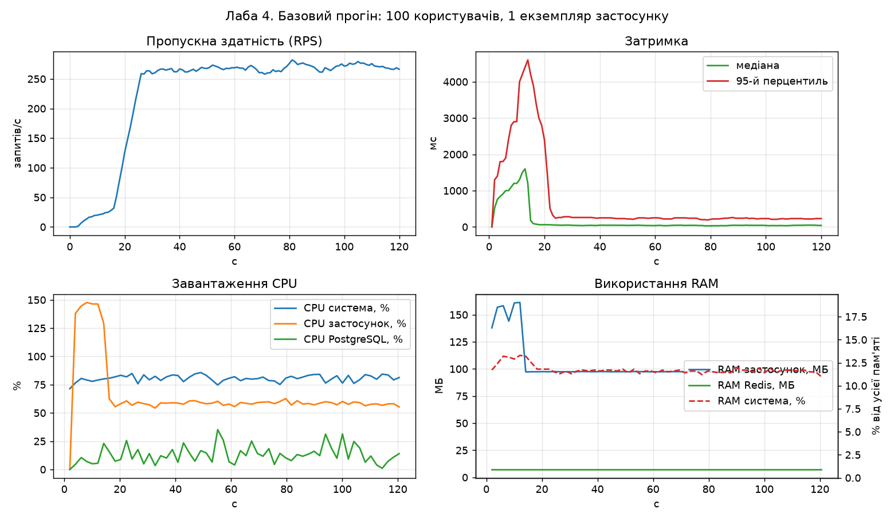

# Лабораторна робота №4. Навантажувальне тестування

## 1. Інструмент і середовище

- **Locust 2.x** (`FastHttpUser`) — сценарій на Python, headless-режим, CSV-звіти. Файл: `backend/loadtest/locustfile.py`.
- Моніторинг CPU/RAM: `backend/loadtest/monitor.py` (psutil, крок 2 с, RAM — PSS).
- Дані: 100 000 укриттів навколо 8 міст (`loadtest/seed.sql`), 100 користувачів (`seed_users.py`).
- Стенд вимірювань: Linux-контейнер **2 vCPU**, PostgreSQL 16 + PostGIS, Redis, Uvicorn (1 процес) і Locust **на одній машині** — тобто вони ділять процесор, абсолютні числа будуть вищими на окремих серверах. Для порівняння «до/після» стенд однаковий.

## 2. Ендпоінти і профіль навантаження

| Задача (вага) | Ендпоінт | Чому |
|---|---|---|
| 10 | `GET /places/nearby` | головний сценарій: пікові read-запити |
| 2 | `GET /places/nearby?type=heating` | фільтр за типом |
| 3 | `GET /places/{id}` | картка об'єкта |
| 2 | `GET /places/{id}/reports` | відгуки |
| 2 | `GET /auth/me` | перевірка JWT |
| 1 | `POST /places/{id}/reports` | запис |
| при старті | `POST /auth/login` | отримання токена |

Профіль: **100 одночасних користувачів**, розгін 10 користувачів/с, тривалість **120 с**, пауза між діями 0,1–0,5 с.

Запуск (з `backend`): `bash loadtest/run_test.sh baseline 100 10 120s http://127.0.0.1:8000`.

## 3. Результати (базова версія)

| Метрика | Значення |
|---|---|
| Запитів | 28 917 |
| **RPS** | **241,4** |
| Latency avg / min / max | 99,1 / 1,6 / 8 936 мс |
| p50 / p95 / p99 | 43 / 260 / 1 000 мс |
| Error rate | 0 % |
| CPU системи avg / max | 80,9 % / 85,7 % |
| CPU застосунку (1 ядро = 100 %) | 58,5 % |
| CPU PostgreSQL | 13,7 % |
| RAM застосунку (макс.) | 97,6 МБ |

За ендпоінтами:

| Ендпоінт | Запитів | avg, мс | p95, мс |
|---|---|---|---|
| `POST /auth/login` | 100 | 2 174 | 5 600 |
| `GET /places/nearby` | 14 345 | 93 | 250 |
| `GET /places/nearby?type=heating` | 2 956 | 93 | 260 |
| `GET /places/{id}` | 4 321 | 87 | 240 |
| `GET /places/{id}/reports` | 2 864 | 72 | 220 |
| `GET /auth/me` | 2 880 | 80 | 240 |
| `POST …/reports` | 1 451 | 153 | 330 |

## 4. Вузькі місця

1. **Хешування паролів (Argon2) блокує event loop.** `/auth/login` — 2,2 с у середньому, а поки йде хешування, усі інші запити стоять у черзі. Звідси хвости p99 = 1 с і max = 9 с.
2. **Навіть прості ендпоінти (`/auth/me`, `/places/{id}`) повільні (≈80 мс)** при низькому навантаженні на БД (PostgreSQL ≈14 % CPU): проблема в одному процесі Python, що насичується (CPU системи ≈81 %, ядро застосунку зайняте).
3. **Геопошук рахує відстань як по сфероїду** (точна, але дорога функція) і вибирає з БД усі колонки ORM-сутності.
4. Один інстанс — єдина точка відмови (вирішує лаба 6).

Рішення описані в [lab7.md](lab7.md).
