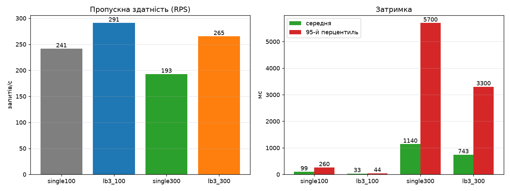

# Лабораторна робота №6. Балансування навантаження (Nginx)

## 1. Реалізація

- **Репліки:** `backend`, `backend2`, `backend3` — один образ, різні `INSTANCE_ID` (профіль compose `lb`). Кожна відповідь має заголовок `X-Served-By`, а `/live` і `/health` повертають `"instance"`.
- **Nginx** (`infra/nginx/nginx.conf`): блок `upstream backend_pool` підключається з файлу вибраного алгоритму (`infra/nginx/upstreams/*.conf`); `server` слухає порт 80 (на хості `8080`) і робить `proxy_pass http://backend_pool`. У лог пишеться `served_by`.
- **Відмовостійкість (passive health checks):** `max_fails=2 fail_timeout=10s` та `proxy_next_upstream error timeout http_502 http_503 http_504` — після двох невдач репліка виключається на 10 с, а поточний запит повторюється на іншій репліці, тож клієнт не бачить помилки.

Запуск (папка `infra`):
```powershell
docker compose --profile lb up --build -d
1..20 | % { curl.exe -s http://localhost:8080/live; "" }        # Round Robin
docker compose stop backend2                                      # імітація збою
1..20 | % { curl.exe -s -o NUL -w "%{http_code} " http://localhost:8080/live }
docker compose start backend2
$env:LB_ALGO="least_conn"; docker compose --profile lb up -d nginx   # інший алгоритм
```

## 2. Round Robin: 20 послідовних запитів

Запити 1–20 обслужили по колу `backend1 → backend2 → backend3`; підсумок за серією: **backend1 = 19, backend2 = 21, backend3 = 20** (у тестовій серії перші два запити потрапили на backend1 — це збіг стану лічильника Nginx на старті). Повний вивід — у [lab6-evidence.txt](lab6-evidence.txt), приклад лога Nginx:

```
upstream=127.0.0.1:8003 served_by=backend3 rt=0.001
upstream=127.0.0.1:8001 served_by=backend1 rt=0.000
upstream=127.0.0.1:8002 served_by=backend2 rt=0.001
```

## 3. Відмовостійкість

Репліку `backend2` зупинено (`kill -9`). Прямий запит до неї — відмова з'єднання. Через Nginx **20 з 20 запитів → HTTP 200**, увесь трафік пішов на живі репліки (`backend1 = 30, backend3 = 30` за серією), а в `error.log` Nginx з'явилось `upstream server temporarily disabled` — тобто репліку автоматично виключено. Після запуску `backend2` і очікування `fail_timeout=10s` вона повернулась у ротацію: 21 / 19 / 20.

## 4. Інші алгоритми (60 запитів)

| Алгоритм | Конфіг | Результат |
|---|---|---|
| Weighted RR (3:2:1) | `weighted.conf` | 31 / 20 / 9 — відповідає вагам |
| ip_hash | `ip_hash.conf` | 60 / 0 / 0 — один клієнт завжди на одну репліку (sticky) |
| least_conn (10 паралельних) | `least_conn.conf` | 17 / 23 / 20 |
| round_robin (10 паралельних) | `round_robin.conf` | 21 / 20 / 19 |

## 5. Порівняння: одна репліка vs три

Код — базова версія з лаби 4, ті самі сценарій і тривалість 120 с.

| Профіль | Конфігурація | RPS | avg, мс | p95, мс | p99, мс | Помилки |
|---|---|---|---|---|---|---|
| 100 користувачів | 1 інстанс | 241,4 | 99,1 | 260 | 1 000 | 0 % |
| 100 користувачів | Nginx + 3 репліки | **290,9** | **33,1** | **44** | 690 | 0 % |
| 300 користувачів | 1 інстанс | 192,8 | 1 140 | 5 700 | 17 000 | 0 % |
| 300 користувачів | Nginx + 3 репліки | **265,2** | **743** | **3 300** | 13 000 | 0 % |



**Висновок.** Три репліки зменшили avg-затримку у 3 рази та p95 у ≈6 разів (260 → 44 мс) при 100 користувачах, бо 3 процеси Python не блокують один одного (GIL). Приріст RPS скромніший (+20 %): стенд має лише 2 vCPU, які ділять Locust, Nginx, PostgreSQL і 3 репліки — при 300 користувачах CPU системи досягав 96–100 %, і саме він став обмеженням. На реальних окремих ядрах/серверах масштабування було б ближчим до лінійного.
