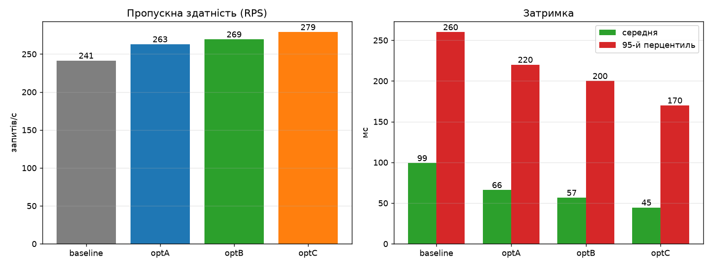

# Лабораторна робота №7. Оптимізація продуктивності

Профіль і інструмент — як у лабі 4 (Locust, 100 користувачів, розгін 10/с, 120 с, один інстанс Uvicorn, той самий `locustfile.py`). Кожен крок — кумулятивний (A → A+B → A+B+C); сценарій не змінювався.

## 1. Вузькі місця й обрані стратегії

| № | Проблема (з лаби 4) | Стратегія | Реалізація |
|---|---|---|---|
| A | Argon2 хешує пароль у потоці event loop → `/auth/login` 2,2 с, хвости p99 | **Алгоритм/конкурентність:** винести хешування в пул потоків з обмеженням `CapacityLimiter` | `hash_password_async`, `verify_password_async` у `core/security.py`; ліміт `PASSWORD_HASH_CONCURRENCY=4` |
| B | Геопошук тягне весь ORM-об'єкт і рахує відстань по сфероїду | **Оптимізація запиту БД:** вибірка лише потрібних колонок + `use_spheroid=false` (сферична модель) | `places.py`: `select(*_columns, distance)`, `ST_Distance/ST_DWithin(..., False)`; `CLUSTER` по GiST-індексу (`scripts/optimize_db.sql`) |
| C | Багато однакових запитів «поруч зі мною» у піку | **Кешування (Redis, TTL 60 с)** | `core/cache.py`, `places.py` |

Бізнес-логіка не змінилась: 48 тестів проходять (у т. ч. 5 нових для кешу).

### Кеш (додаткове завдання 1)

- Ключ: `nearby:<версія>:<lat>:<lon>:<radius>:<type>:<only_available>:<limit>`; координати округлюються до 3 знаків (≈110 м) — сусідні запити потрапляють в один запис.
- **TTL = 60 с** (`CACHE_TTL_SECONDS`) + миттєва інвалідація: створення/зміна/видалення укриття збільшує лічильник `nearby:version`, старі ключі перестають використовуватись.
- **Fail-open:** якщо Redis недоступний — запит іде в БД, відповідь має `X-Cache: BYPASS` (тест `test_app_keeps_working_when_redis_is_down`).
- Заголовок `X-Cache: HIT | MISS`. Вмикається `CACHE_ENABLED=true`.
- Компроміс: до 110 м неточності центру пошуку й до 60 с застарілих даних при зміні напряму поза API.

## 2. Результати «до / після»

| Метрика | До (baseline) | A | A+B | A+B+C (кеш) | Зміна (до → після) |
|---|---|---|---|---|---|
| Запитів за 120 с | 28 917 | 31 492 | 32 258 | 33 382 | +15 % |
| **RPS** | 241,4 | 263,0 | 269,4 | **278,9** | +15,5 % |
| Latency avg, мс | 99,1 | 66,1 | 56,6 | **44,6** | −55 % |
| p50, мс | 43 | 30 | 14 | **10** | −77 % |
| **p95, мс** | 260 | 220 | 200 | **170** | −35 % |
| p99, мс | 1 000 | 540 | 650 | 740 | −26 % |
| Max, мс | 8 936 | 3 224 | 5 197 | 3 447 | −61 % |
| Error rate | 0 % | 0 % | 0 % | 0 % | — |
| CPU системи avg | 80,9 % | 75,0 % | 67,7 % | **62,5 %** | −18 п.п. |
| CPU PostgreSQL avg | 13,7 % | 10,6 % | 11,5 % | 14,5 % | — |
| RAM застосунку max, МБ | 97,6 | 89,8 | 90,0 | 96,7 | ≈ |
| RAM Redis max, МБ | 7,3 | 5,0 | 5,0 | 50,2 | +43 |



Приріст за кроками (avg latency): A −33 % (99 → 66), B ще −14 % (66 → 57), C ще −21 % (57 → 45).

**Висновки.**
1. **Найбільший ефект дала оптимізація A (асинхронне хешування паролів):** −33 мс avg і −46 % p99, бо усунула блокування event loop — хоч на дані запити впливає лише логін, він блокував усіх.
2. Крок B (запит + `CLUSTER`) зменшив медіану з 30 до 14 мс — основний вплив на `/places/nearby` (≈60 % трафіку).
3. Кеш C зменшує навантаження на БД, але на цьому профілі RPS зріс лише на 3,5 %: Locust, Uvicorn і PostgreSQL ділять 2 vCPU, а один процес Python (і сам Locust) стали обмеженням; p99 трохи зріс (650 → 740 мс) — у межах шуму між прогонами (max/p99 визначають поодинокі довгі запити під час розгону). Кеш важливіший при зростанні кількості різних запитів та більшому розмірі БД.
4. Одиничний прогін — не статистика: різницю в 5–10 % між A+B та C слід трактувати обережно. Для захисту варто повторити прогони 3 рази (`run_test.sh`) і взяти медіану.

Масштабування репліками (лаба 6) дало більше за будь-яку з цих трьох оптимізацій окремо (avg 99 → 33 мс), але вони взаємодоповнюють одна одну.

## 3. EXPLAIN ANALYZE (додаткове завдання 2)

Запит геопошуку (радіус 2 км, 100 000 рядків, `LIMIT 20`).

**До: без GiST-індексу `idx_places_location`** — Parallel Seq Scan:

```
Gather Merge ... (actual time=155.515..168.614 rows=20)
  -> Sort (top-N heapsort)
     -> Parallel Seq Scan on places  (actual time=81.333..89.235 rows=164 loops=2)
          Filter: st_dwithin(location, ..., 2000, false)
          Rows Removed by Filter: 49836
          Buffers: shared hit=2044
Planning Time: 4.247 ms
JIT: Total 533.602 ms
Execution Time: 2088.933 ms
```

**Після: з індексом** — Bitmap Index Scan:

```
Limit (actual time=7.908..7.911 rows=20)
  -> Sort (top-N heapsort)
     -> Bitmap Heap Scan on places (actual time=7.420..7.831 rows=329)
          Filter: st_dwithin(location, ..., 2000, false)
          Rows Removed by Filter: 235
          Heap Blocks: exact=24
          -> Bitmap Index Scan on idx_places_location (actual time=0.125..0.125 rows=564)
               Index Cond: (location && _st_expand(..., 2000))
Buffers: shared hit=130
Execution Time: 8.022 ms
```

| | Без індексу | З індексом |
|---|---|---|
| Execution Time (план вище, перший холодний запуск) | 2 089 мс | **8,0 мс** |
| Execution Time (2 повторні запуски) | 254 і 296 мс (з них JIT ≈ 200–240 мс) | 6,7 мс |
| Прочитано буферів | 2 081 | 130 |
| Рядків перевірено | 100 000 | 564 |

Перший (холодний) запуск без індексу був аномально довгим (2 с); у повторних запусках — ≈ 250–300 мс проти ≈ 7–8 мс з індексом, тобто приріст ≈ **35–40×** (до 260× у холодному випадку); під навантаженням, коли Seq Scan конкурує за CPU, різниця ще більша. Повні плани: [explain-noindex.txt](explain-noindex.txt), [explain-index.txt](explain-index.txt). Індекс створює міграція `0001_initial.py`, тому в усіх прогонах (включно з baseline) він був; план «без індексу» отримано тимчасовим `DROP INDEX` усередині транзакції з `ROLLBACK`. Відновити план у себе:

```sql
EXPLAIN (ANALYZE, BUFFERS) SELECT id, name FROM places
WHERE ST_DWithin(location, ST_SetSRID(ST_MakePoint(25.94,48.29),4326)::geography, 2000, false)
ORDER BY ST_Distance(location, ST_SetSRID(ST_MakePoint(25.94,48.29),4326)::geography, false) LIMIT 20;
```
