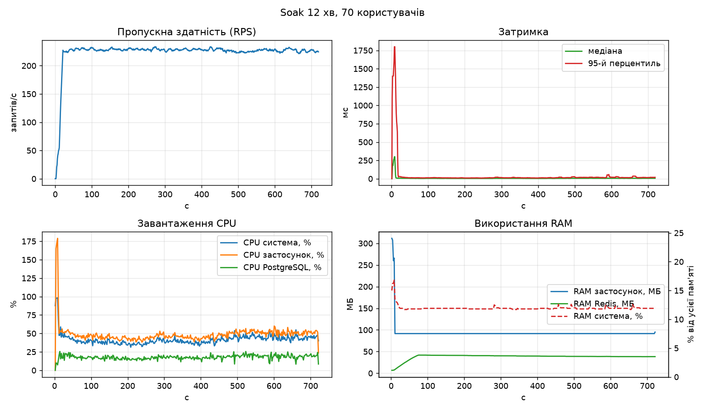
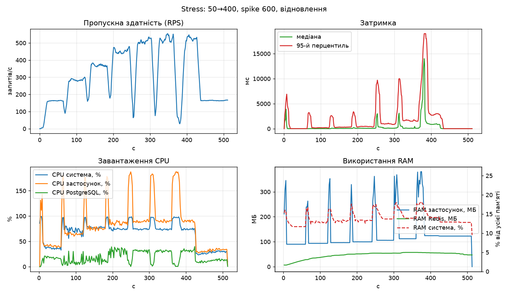

# Лабораторна робота №8. Soak- та stress-тестування

## 1. Профіль стабільності

- Максимальний RPS, знайдений у попередніх роботах для одного інстансу: ≈ 280–290 (лаби 4, 6, 7); при stress-тесті насичення настає на ≈ 440 RPS (кеш увімкнено).
- Профіль soak: **70 користувачів** (пауза 0,1–0,5 с) → **≈ 226 RPS ≈ 80 % від 279 RPS** (результат лаби 7 з кешем).
- Конфігурація: фінальна (оптимізації A+B+C, `APP_ENV=sandbox DEBUG=false CACHE_ENABLED=true`), 1 інстанс Uvicorn, PostgreSQL, Redis.
- Критерії успіху: **CPU ≤ 80 %, RAM ≤ 80 %, error rate ≤ 0,1 %**; додатково — відсутність зростання RAM і деградації p95.

Команда (з `backend`): `bash loadtest/run_test.sh soak 70 10 <тривалість> http://127.0.0.1:8000`; для повного прогону — `4h` (або `1h`). Збір CPU/RAM кожні 2 с — `loadtest/monitor.py`.

> **Обмеження.** Через ресурси середовища повноцінний прогін 1–4 год не проводився: виконано **12 хв (720 с)**, ≈ 162 тис. запитів. Це доводить стабільність на цьому інтервалі, але не замінює багатогодинний тест — запустіть команду вище на своєму ПК/сервері та підставте числа у таблицю.

## 2. Результати soak (12 хв)

| Метрика | Значення | Критерій |
|---|---|---|
| Запитів | 162 359 | |
| **RPS** (середній) | **225,7** | |
| Latency avg / min / max | 8,2 / 0,8 / 2 714 мс | |
| p50 / p95 / p99 | 5 / 15 / 32 мс | |
| **Error rate** | **0 %** | ≤ 0,1 % ✔ |
| CPU системи avg / max | 40,9 % / 55,2 % | ≤ 80 % ✔ |
| RAM системи avg / max | 11,9 % / 12,6 % | ≤ 80 % ✔ |
| CPU застосунку avg | 47,5 % (1 ядро) | |
| RAM застосунку (діапазон після 2 хв) | 91,5 – 95,0 МБ | |
| CPU PostgreSQL avg | 17,8 % | |
| RAM Redis max | 41,9 МБ | |

Максимум 2,7 с належить першій хвилині (логін 70 користувачів і «холодний» кеш); див. нижче.



### Стабільність за хвилинами

| Хвилина | 0 (розгін, холодний кеш) | 1 | 2 | 4 | 6 | 8 | 10 | 11 |
|---|---|---|---|---|---|---|---|---|
| RPS | 175 | 229 | 229 | 229 | 228 | 225 | 228 | 226 |
| p95, мс | 342 | 12,8 | 12,1 | 13,7 | 11,7 | 18,4 | 18,4 | 19,0 |
| avg, мс | 125,8 | 22,5 | 15,0 | 10,4 | 8,9 | 8,3 | 8,3 | 8,2 |

## 3. Аналіз довгострокової поведінки

- **Витік пам'яті:** RSS застосунку після прогріву коливається 91,5 → 95,0 МБ, лінійний тренд **+0,007 МБ/хв** (≈ 0) — витоку немає; RAM системи ≈ 12 %.
- **Деградація latency:** після розгону RPS і avg стабільні (avg плавно падає з 22 до 8 мс, коли кеш прогрівається). Невелике зростання p95/p99 в кінці (12 → 19 мс, p99 18 → 50 мс) ймовірно пов'язане зі спливанням TTL кешу (60 с) — одночасна повторна вибірка з БД (гіпотеза, окремо не перевірялась); різниця мала, але на довшому прогоні за цим трендом треба стежити. Для багатогодинного прогону варто стежити за цим трендом.
- **З'єднання з БД:** пул (`DB_POOL_SIZE=10`, `DB_MAX_OVERFLOW=10`) не вичерпувався — помилок немає.
- **Не перевірялось за 12 хв:** заповнення диска логами, повільне фрагментування таблиць — це можливо виявити лише на годинному прогоні.

## 4. Висновок про готовність

На профілі ≈ 80 % від максимуму система 12 хв працювала без помилок, із CPU 41 % (макс. 55 %), RAM 12 %, p95 = 15 мс та без ознак витоку. Критерії лаби виконані. Для рішення про експлуатацію обов'язково повторити soak на 1–4 год на цільовій інфраструктурі (контейнери Docker, окремі від Locust ядра).

## 5. Stress / spike тест і точка зламу (додаткове завдання 1)

Сценарій `loadtest/stress_shape.py` (Locust `LoadTestShape`): сходинки по 60 с — 50 → 100 → 150 → 200 → 300 → 400 користувачів, **spike 600** на 60 с, повернення до 50 на 90 с.

| Сходинка (користувачів) | RPS | p50, мс | p95, мс | p99, мс | Помилки |
|---|---|---|---|---|---|
| 50 | 157 | 6 | 44 | 333 | 0 |
| 100 | 278 | 24 | 206 | 338 | 0 |
| 150 | 361 | 65 | 335 | 601 | 0 |
| 200 | 439 | 89 | 474 | 820 | 0 |
| 300 | 445 | 184 | **1 989** | 3 162 | 0 |
| 400 | 463 | 197 | 2 600 | 4 073 | 0 |
| **600 (spike)** | **359** | 2 652 | 8 009 | 10 443 | 0 |
| 50 (відновлення) | 167 | 4 | 9 | 13 | 0 |



- **Точка зламу — ≈ 200–300 користувачів (~440 RPS):** RPS перестає рости, а p95 стрибає з 0,5 до 2 с (CPU системи доходить до 99 %). Це насичення CPU, не помилки: усі 158 972 запити закінчились без жодної відмови.
- **Spike 600 користувачів:** пропускна здатність падає до 359 RPS, p95 = 8 с — система деградує, але не падає.
- **Відновлення:** одразу після зниження навантаження до 50 користувачів p95 = 9 мс, p99 = 13 мс (середнє у вікні 15–90 с після зниження; перші 15 с у таблицю не входять) — застосунок відновився сам, ручне втручання не потрібне.
- Практичне правило: тримати робоче навантаження до ≈ 150–200 користувачів на інстанс (≈ 350–440 RPS), далі додавати репліки (лаба 6).

## 6. Моніторинг Prometheus + Grafana (додаткове завдання 2)

Застосунок віддає `/metrics` (`http_requests_total`, `http_request_duration_seconds`, `http_requests_in_flight`). Файли: `infra/monitoring/prometheus.yml`, `infra/monitoring/grafana/provisioning/**`, дашборд `infra/monitoring/grafana/dashboards/shelter.json` (RPS за інстансами, p95, p99, частка 5xx, запити в обробці, топ ендпоінтів).

```powershell
cd infra
docker compose --profile lb --profile monitoring up --build -d
# Grafana: http://localhost:3000  (admin / значення GRAFANA_PASSWORD, за замовчуванням admin)
# Prometheus: http://localhost:9090/targets  — усі 3 репліки мають бути UP
# запустіть навантаження (locust) — дашборд оновлюється кожні 5 с
```

Дашборд **Shelter Map — навантаження** підключається автоматично (папка *Shelter Map*). Для звіту зробіть скриншот під час навантаження.

> **Чесна примітка.** Prometheus/Grafana у моєму середовищі не запускались (Docker Hub недоступний) — конфігурація складена за документацією і перевірена лише на валідність YAML/JSON; метрики `/metrics` перевірені тестами. Якщо дашборд покаже «No data» — перевірте `/targets` у Prometheus.
